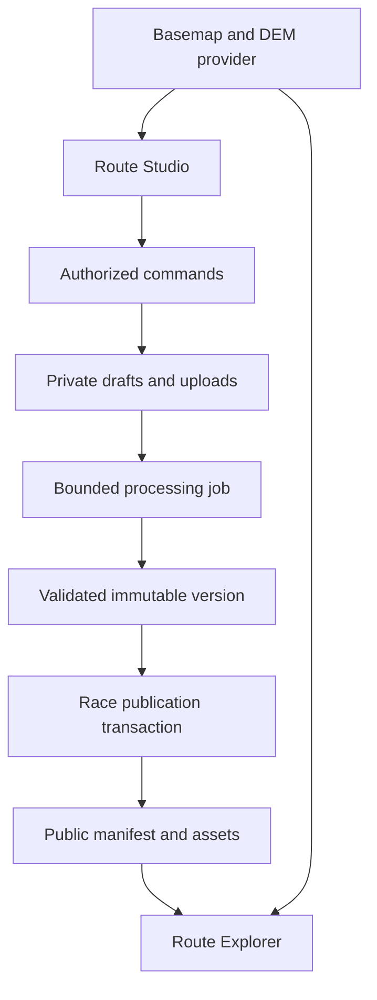

# RacePulsePH Route Explorer and Route Studio

Research and implementation plan, 16 November 2026 (Asia/Manila).

**Status: planning only. No application code, packages, rules, infrastructure, or live race data changed.**

## 1. Recommended decision

Build a new public **Routes** page with an interactive geographic map, synchronized elevation profile, race-distance selection, checkpoints, and organizer-provided photo landmarks. Build a separate **Route Studio** page where authorized administrators and approved, scoped organizers can import or draw a course, annotate it, save a reusable preset, and assign an immutable version to a race distance.

Use **MapLibre GL JS + Terra Draw + @tmcw/togeojson + selected Turf modules**, with a small accessible SVG elevation chart. Keep the existing React, TypeScript, Tailwind, Firebase Auth, Firestore, Storage, and Cloud Functions architecture. Start the pilot with OpenFreeMap basemaps. Prepare a controlled production map option using a regional Protomaps PMTiles archive, object storage, and a CDN. Compute elevation once during route preparation, then serve the saved profile to every viewer.

This is technically feasible in the current app. It is a substantial feature rather than a drop-in GPX viewer. The work includes publishing/versioning, authorization, route processing, geographic accuracy, mobile interaction, and operational review.

The mapping libraries are open source. Firebase and managed hosting remain services with their own pricing and terms. This proposal does not describe the entire RacePulsePH backend as open source or promise zero operating cost.

### Decisions used throughout this plan

| Topic | Proposed default | Why |
| --- | --- | --- |
| Public audience | Everyone, including signed-out visitors, can view explicitly published race routes | Matches “all users” and makes race links shareable |
| Editing audience | Admins under existing scope; approved organizers for their permitted presets and races | Extends the app's established access model |
| “Trademark (photo snippet)” | A named landmark with a real photo, caption, credit, and route position | Interprets the request as recognizable course locations; a sponsor logo can be a separate credited asset |
| New navigation | Routes for viewers; Route Studio for editors | Keeps exploration separate from publishing work |
| First release | Imported/drawn routes, map, elevation, markers, photos, presets, per-distance assignment, versioning | Delivers all core requested capabilities |
| Enhanced release | Terrain relief, route chapters, category comparison, authorized offline packs | Adds visual depth after core data is reliable |
| Location tracking | Excluded from the initial release | Viewing and planning a route does not require collecting runner locations |
| Approval boundary | This document authorizes no implementation or deployment | The current request is research and a Markdown plan only |

## 2. What already exists in this repository

Inspected the working tree on `main`, base commit `baa85f2`. Several files already contain unrelated uncommitted work, including access controls and runner screens. The working tree, rather than only the commit, is the baseline. Recheck it before implementation and preserve those changes.

| Source | Verified current behavior | Consequence for implementation |
| --- | --- | --- |
| `package.json` | React 19, TypeScript, Vite 6, Tailwind 4, Firebase 12, Capacitor 8, Playwright; no map engine dependency | Add lazy-loaded map packages; retain the existing stack |
| `src/types.ts` | `Race` has `routeMapUrl`, `routeGpxUrl`, filename/upload time; `RaceDistance` has a stable `id` | Migrate existing GPX data and bind new courses by distance ID |
| `src/types.ts` | Timing `Checkpoint` has ID, label, order, type, optional cutoff; no coordinates | Add a geographic annotation model with explicit links to timing IDs |
| `src/lib/gpxRoute.ts` | Browser XML parsing, Haversine distance, raw ascent/descent sums; 8 MB check and 100,000-point slicing | Replace silent truncation and improve segment/elevation integrity |
| `src/components/RouteMap3D.tsx` | Rotatable SVG projection of route points, plus a link to the route center on OSM | This is a schematic preview, not a geographic basemap or terrain engine |
| `src/components/RaceSetupPanel.tsx` | Uploads `race-assets/{uid}/{raceId}/route-*.gpx`; access currently follows `race.artwork` | Introduce a route-specific workflow and separate private upload paths |
| `src/components/PublicRaceResults.tsx`, `src/components/RunnerDashboard.tsx` | Display the existing GPX preview | Add a course summary and link to the dedicated viewer after migration |
| `src/components/PublicLiveRaceHub.tsx` | Handles external route-map links/embeds | Integrate the new viewer without coupling map availability to broadcasting |
| `src/App.tsx` | Manual URL parsing/history handling; current path normalizer lowercases the whole pathname | Add explicit route parsing, preserve case-sensitive IDs, and test refresh/back/forward |
| `src/components/AuthorizedWorkspace.tsx` | Uses `AdminDashboard` as the operations workspace for authorized roles | Add Route Studio to this active path; do not assume the older organizer component controls navigation |
| `src/components/AdminDashboard.tsx`, `BottomNav.tsx`, `WorkspaceShell.tsx` | Capability-filtered tabs and shared desktop/mobile navigation | Add a real page destination through the existing shell |
| `functions/access-policy.js`, `scripts/build-access-rules.cjs` | Permission catalog and generated client/rule outputs | Extend the authoritative policy and generator, not only generated files |
| `firestore.rules` and generator | Race updates have an allowed-field list | Any new race pointer must be deliberately included or kept server-owned |
| `storage.rules` | Current `race-assets` reads are public | Never put new private drafts or original GPX files in that namespace |
| `src/lib/racesStore.ts` | Shared listener reads the races collection | Keep full geometry and photos out of race documents and catalog listeners |
| `firebase.json` | SPA rewrite already exists; CSP `connect-src` lacks map-provider hosts; geolocation is disabled by Permissions Policy | Map-provider requests need a narrowly scoped CSP update; no geolocation change is needed for core viewing |
| `public/sw.js` | Caches same-origin app assets, skips external requests, clears caches outside its current cache name on activation | Offline route packs require deliberate storage/version handling; they will not work automatically |
| `.impeccable.md`, `.agents/rules/frontend.md`, `src/index.css` | Athletic red/charcoal identity, light/dark tokens, layout and proof requirements | Design a content-led map workspace consistent with RacePulsePH |

### Current parser issues that the new pipeline must address

- `trkpt` and `rtept` are flattened together, so separate tracks or segments can become artificial connecting lines.
- Point counts above the cap are silently sliced, potentially hiding the finish. Reject oversize input explicitly.
- A missing latitude/longitude attribute passes through `Number(null)` as zero. Missing values must be rejected before numeric conversion; valid zero coordinates remain allowed.
- String length is not a reliable uploaded byte limit. Enforce the actual byte size during upload and bounded server reads.
- Elevation gain sums raw differences, which can amplify GPS noise. Missing elevation currently produces misleading zero totals.
- The schematic projection scales latitude, longitude, and elevation independently. It must not be used as evidence of true terrain shape or elevation accuracy.

These are source observations, not production incident claims. This planning task has not modified or runtime-tested them.

## 3. Product experience and differentiation

The useful goal behind “cooler than Strava” is a race-specific course briefing that helps a runner understand the event. Strava already documents route planning, elevation, custom waypoints, 3D maps, and flyovers [S16]. Do not advertise those features as unique or claim superiority without user testing.

### Proposed standout features

| Experience | What the runner sees or does | Implementation approach | Release |
| --- | --- | --- | --- |
| Synchronized exploration | Scrub elevation and see the same point selected on the map; tap a checkpoint to inspect both | Shared distance-along-course selection state | Core |
| Course identity | Race name, distance category, course version, organizer review date | Explicit race binding and publication metadata | Core |
| Photo landmarks | Tap “Bridge entrance” or “Ridge viewpoint” to see a genuine photo and short course instruction | Anchored landmark records and processed thumbnails | Core |
| Checkpoint preparation | See distance from start, distance from previous checkpoint, services, and any applicable cutoff | Geographic annotations with optional timing links | Core |
| Route direction | Start/finish symbols, direction arrows, lap/pass labels | Ordered geometry and occurrence-aware markers | Core |
| Terrain reading | Switch between 2D and real terrain relief with an honest elevation source label | MapLibre raster DEM layer, separate from numerical profile | Enhanced |
| Route chapters | Select “Start”, “First climb”, “Aid station”, “Finish” to inspect that section and its photo | Organizer-curated chapter anchors; instantaneous camera changes | Enhanced |
| Distance comparison | Compare two race categories on a common map and aligned summary | Distinct line patterns plus separate profiles; cap at two on mobile | Enhanced |
| Personal preparation estimate | Enter a pace and stopping allowance to estimate checkpoint arrivals | Local calculation, clearly labeled estimate; no athlete tracking | Later |
| Course change clarity | See which published version is current and what changed | Version summaries, immutable race bindings, stale-pack warnings | Core |
| Shareable preparation | Copy a deep link, show QR, download sanitized GPX | Existing QR dependency and version-aware download | Core |

Do not add fabricated popularity figures, generated landmark photos, fake live runner dots, or invented surface/aid information. Unknown data stays unknown. A route preview marker must be labeled “Preview position,” never “Live runner.”

### Proposed user validation

After a working beta exists, recruit 5 to 8 representative runners and 2 organizers. Ask them to find the next aid station, identify the largest climb, locate a photo landmark, choose the correct race category, and publish a revised course safely. Record task completion, mistakes, and time. These are proposed study sizes and tasks, not collected results. Compare the same preparation tasks with the existing RacePulse preview and, where available, a comparable Strava route before making comparative claims.

## 4. Page structure and navigation

| URL | Page | Access and behavior |
| --- | --- | --- |
| `/routes` | Route Explorer catalog | Public, contains only published race-course entries |
| `/races/:raceId/routes/:distanceId` | Race course viewer | Public current publication for that exact race distance |
| `/races/:raceId/routes/:distanceId?v=:publicationId` | Versioned course link | Published historical version with a visible current-version notice; withdrawn content is unavailable |
| `/route-studio` | Preset library | Authorized editor, scoped list of editable/shared presets |
| `/route-studio/:presetId` | Course editor | Authorized editor; draft and published-version inspection |

The viewer is the new public page the user requested. Route Studio is its administrative companion. Add Routes to public navigation and runner navigation; add Route Studio to operations navigation. From a race detail or My Races screen, open the selected distance directly. From Race Setup, “Choose route preset” opens a selection flow into Route Studio while retaining the race/distance context.

Preserve the current routing strategy for this feature. Extract a small, typed route matcher instead of introducing a full router migration. Match literal path segments case-insensitively if desired, but preserve opaque IDs exactly. Reject invalid IDs, use encoded path/query values, maintain browser history, and allow only internal return destinations after sign-in. Do not treat `?register=` as a reason to override a valid course URL.

Resolve public course URLs before the authenticated workspace branch so signed-in users and guests see the same published course. An editor deep link survives sign-in and opens only after authorization. Browser Back and Android hardware Back close a photo/dialog first, then leave the course; unsaved editor changes receive the existing branded confirmation.

### Desktop composition

Use a functional title/action row, followed by a map workspace and elevation profile. The map takes the main area; a 320 to 384 px details rail shows checkpoint/landmark content. Put the profile immediately below the map, approximately 160 to 200 px high. The rail can scroll within the available workspace, with its current item synchronized to the map. At 1280 px, reduce the rail before compromising map controls. Do not add a decorative hero, unrelated cards, or fixed empty space.

### Mobile composition

Use the race/category selector, a roughly 320 to 400 px map, the profile, and a checkpoint/landmark list in ordinary document flow. Use an explicit Map/Details switch or accessible expandable details surface when height is limited. A drag-only bottom sheet is insufficient. Keep navigation safe areas clear and attribution visible. Do not trap ordinary page scrolling in the map; use cooperative gestures and clear zoom controls.

### Route Studio composition

Use a full workspace with sections for Course, Markers, Photos, Race Assignment, and Versions. Provide Save Draft, Review, and Publish in a persistent action region. On a phone, sections reflow into a scrollable section bar and form-driven marker editor. Every important drag operation also has a keyboard/form alternative. Dense imported tracks use segment-level editing, not thousands of individual draggable handles.

## 5. Open-source technology evaluation

The suitability judgments below are engineering recommendations for this app, not library benchmark results. Pin specific compatible stable versions only after a small compatibility spike; do not install prereleases merely because they are newest.

| Candidate | Strength for this use | Tradeoff | Decision |
| --- | --- | --- | --- |
| MapLibre GL JS | Vector styles, geographic overlays, GPU rendering, terrain support [S1, S2] | Requires WebGL, real tile hosting, and worker/CSP integration | Recommended map engine |
| Leaflet | Straightforward 2D maps, markers, GeoJSON, broad plugin model [S17] | Real terrain and this style system require additional engines or compromises | Good simpler alternative; do not ship alongside MapLibre by default |
| OpenLayers | Rich GIS formats, projections, tiled/vector layers [S18] | More GIS capability than this feature needs; terrain experience requires extra work | Reconsider if future requirements become GIS-centric |
| Strava route embed | Existing interactive external route presentation [S16] | Does not provide RacePulse-owned preset editing, permissions, or timing bindings | Optional outbound link, not the primary integration |
| Current custom SVG preview | Already present and independent of map tiles | Schematic, no real basemap, misleading if treated as terrain | Transitional fallback only |

### Recommended package and service responsibilities

| Technology | Responsibility | License/service note | Reason |
| --- | --- | --- | --- |
| `maplibre-gl` | Map, route layers, marker selection, terrain | BSD-3-Clause core plus bundled notices [S1] | One map renderer across browser and Capacitor WebView |
| `terra-draw` + `terra-draw-maplibre-gl-adapter` | Admin point/line drawing and editing | MIT project [S3] | Purpose-built editor tooling rather than bespoke geometry handles |
| `@tmcw/togeojson` | GPX-to-GeoJSON conversion | BSD-2-Clause project [S4] | Supports GPX constructs and browser/Node use; does not replace validation |
| `@xmldom/xmldom` | XML DOM adapter in Node and, if needed, the processing worker | Verify the pinned package/license and advisories during dependency review | Workers and Node do not supply the window's DOMParser |
| Selected `@turf/*` modules | Geodesic distances, snapping, bounds, display simplification | MIT [S5] | Reuse spatial primitives while controlling bundle size |
| React SVG + `d3-scale`, `d3-shape` | Elevation chart, axes, line/area paths | ISC modules [S6] | Custom interaction without a second heavy chart framework |
| `pmtiles` | Later browser reads of regional map archives | Check pinned package notices; Protomaps integration documented [S9] | Controlled hosting and provider portability |
| OpenFreeMap | Pilot vector basemap | MIT hosting project; map/data attribution and service terms still apply [S7, S8] | Quick pilot with a replaceable provider |
| Open Topo Data + regional SRTM | Missing-elevation processing | MIT server; data has separate provenance [S10, S11] | Open-source server option and reproducible elevation lookup |
| Firebase services | Accounts, metadata, files, processing, publishing | Existing managed services, usage billed separately [S14, S15] | Avoid an unrelated backend replacement |
| `sharp` in processing service | Decode/re-encode images, resize, strip metadata | Verify pinned package and container compatibility | Reliable image hygiene outside the browser |
| Existing `qrcode.react`, Lucide, feedback/dialog components | Share QR, controls, feedback | Reuse installed dependencies | Avoid duplicating UI infrastructure |

Use MapLibre directly inside one React lifecycle adapter rather than adding a wrapper solely for convenience. Create one map per visible viewer/editor, clean up listeners and workers on unmount, handle React development remounts, observe container resizing, and restore route layers after a style switch. Keep map instances and pointer events out of broad React context updates.

Terra Draw edits geometry; it does not automatically find roads. Optional snap-to-road routing requires a separate service, described in section 13.

## 6. Map data, terrain, and hosting decisions

### Basemap pilot

Use OpenFreeMap's documented styles through a provider configuration layer. Store RacePulse's style choice and attribution requirements in configuration; never scatter provider URLs through components. Test the actual Philippines courses and the selected light/dark styles. A style that shows extruded buildings is not evidence that elevation terrain is available.

OpenFreeMap currently describes its public service as free and provided as-is [S8]. It can support a pilot, but no release plan should invent an uptime guarantee. Keep readable course information and a retry path available when map tiles fail.

### Controlled production option

Before a large race-day rollout, prepare a **regional Protomaps PMTiles** archive, hosted on Cloudflare R2 with a production custom domain/CDN, or an equivalently tested Google Cloud Storage/CDN deployment. Include the actual race region plus surroundings; measure archive size instead of assuming a whole-country extract is small. Publish versioned archive filenames and immutable assets.

PMTiles uses HTTP Range requests and needs compatible CORS/ETag behavior [S9]. Verify `206` responses, `Range`/`If-Match` support where used, exposed ETag, and cache behavior from web and Capacitor origins. Avoid routing every tile through a billable Firebase function. Host style JSON, fonts, and sprites intentionally; owning the archive alone does not remove external font/style dependencies. Keep the previous map release available during updates.

OpenFreeMap and Protomaps can use different vector-layer schemas. Provider switching must replace the complete compatible style/source/font/sprite bundle and then restore app overlays; changing only a tile URL is unsafe.

Do not rely on the standard OSM raster server as unlimited production infrastructure. Its policy forbids bulk prefetching and requires attribution and appropriate caching [S12]. Preserve the attribution required by each selected map/data source in the app, screenshots, exports, and any share artwork.

### Real 3D terrain

Elevation values along a GPX line do not create a 3D terrain surface. Terrain needs raster DEM tiles in a supported encoding [S2]. The enhanced release will:

1. Acquire the SRTM tiles covering the supported race region and retain source/version metadata.
2. Process a regional elevation mosaic in a reproducible GIS build environment, including nodata handling and edge checks.
3. Generate PNG elevation tiles using a reviewed `rio-rgbify` pipeline, with explicit base/interval settings compatible with MapLibre's chosen encoding [S19]. Export tile assets or convert a verified MBTiles archive through a supported serving workflow.
4. Host immutable terrain tiles and their attribution under the controlled map domain. Include an overlap margin around course bounds to avoid clipped hills.
5. Test decoded sample elevations against the source DEM, tile orientation, seams, coastline nodata, zoom limits, and WebView performance.
6. Keep 2D as the mobile default and disable 3D when the DEM/provider/device cannot support it.

Terrain exaggeration defaults to 1.0. If a higher visual exaggeration is exposed later, label it. Never compute official profile statistics from the rendered terrain: MapLibre's documented terrain query reflects exaggeration [S20]. The stored numerical profile remains authoritative for display, regardless of camera pitch.

Satellite imagery is outside the initial scope. OSM vector data does not include a licensed satellite basemap. Add imagery only after selecting a provider and checking its separate display, caching, attribution, and price terms.

## 7. System architecture

Separate the control plane (drafts, permissions, publication pointers) from heavy assets (geometry, profiles, photos, tiles). Most viewers need a small public manifest and cached files. They should not trigger an elevation API request, XML parsing, or a long-lived listener for every point.

Use a dedicated Firebase HTTPS/callable route-command API and a processing worker. The existing deployed backend lives under `functions/`; local `server.ts` is not automatically the production API because Firebase Hosting currently rewrites all paths to the SPA. Choose one explicit deployment path: a new route function endpoint, optionally with a specific Hosting rewrite before the catch-all. Carry the same authentication and access checks through local development.

For bounded GPX/image jobs, start with Cloud Functions v2 plus a durable task mechanism. Record a job ID and use idempotent storage-finalize/task processing. A private Cloud Run container is an option if XML/image/elevation workloads exceed function limits. The larger DEM/tile build runs as an offline build job, not on each upload or view. Set memory, concurrency, time, and retry limits after measured fixtures.

### Backend command contract

Use one consistent command envelope with an operation name, target IDs, expected revision, and idempotency key. The server derives the actor from verified authentication. Do not accept a client-provided owner/role as authority.

| Command | Input concept | Server result and invariant |
| --- | --- | --- |
| Create preset/draft | Title, region, optional authorized source version | New IDs and revision; copied data must be readable by this actor |
| Begin upload | Draft, revision, declared type/bytes | Bounded private object path/session; revalidate actual bytes later |
| Process draft | Draft, input object generation/hash, selected segments | Job ID; deterministic output can only attach to the matching draft revision |
| Save draft | Expected revision, bounded geometry/marker edits | New revision or conflict; server validates schema and ownership |
| Create version | Ready draft, expected revision, review acknowledgements | Immutable version ID with checksums; no implicit race reassignment |
| Publish race binding | Race/distance, preset version, checkpoint mapping, expected binding revision | New publication ID and current pointer after full scope/validation checks |
| Roll back/withdraw | Race binding, expected revision, reason, target where applicable | Audited state change and public-serving/cache policy update |
| Archive preset | Preset, expected revision | Stops new use while preserving published race references |

Return structured validation/conflict errors that the UI can display without leaking stack traces. Distinguish unauthenticated, forbidden, not found/unavailable, revision conflict, invalid input, rate-limited, and temporary provider failure. Apply timeouts and bounded retries to jobs; a client retry must not create duplicate versions/publications.

## 8. Data model and versioning

### Essential separation

A **preset** is a reusable course definition. A **version** freezes geometry, landmarks, photos, profile methodology, and provenance. A **race binding** selects a specific preset version for one race distance and adds race-specific checkpoint links, services, cutoffs, and notices. A **publication** is the sanitized public snapshot of that binding.

Editing a preset must never silently change a published race. Reusing the same course next year should carry the geography and reusable landmarks but require reconfirmation of staffing, services, access, dates, and cutoffs.

### Proposed storage entities

| Entity/path | Contents | Access/size approach |
| --- | --- | --- |
| `routePresets/{presetId}` | Owner/editor IDs, title, region, activity, archive status, latest draft/version pointers | Private scoped metadata; target below 64 KiB |
| `routePresets/{presetId}/drafts/{draftId}` | Revision, input asset IDs, selected segments, processing state, edit summary | Private; compare-and-swap writes |
| `.../drafts/{draftId}/markers/{markerId}` | Editable landmark/checkpoint annotations | Private bounded documents |
| `routePresets/{presetId}/versions/{versionId}` | Immutable manifest pointers, hashes, calculations version, provenance, review metadata | Private authoritative version record |
| `routeJobs/{jobId}` | Status, attempts, input object generation/hash, output pointers, safe error codes | Editor-visible status; server-owned transitions |
| `races/{raceId}/routeBindings/{distanceId}` | Chosen preset/version, binding revision, race-specific annotations, current publication ID | Private or strictly sanitized; server-owned binding changes |
| `publishedRaceRoutes/{publicationId}` | Sanitized race/category summary, geometry/profile/media manifest pointer, status, release time | Public only while publication status permits; no private fields |
| `raceRouteCatalog/{entryId}` | Current race/distance public summary and publication ID | Small public catalog entries; cursor pagination |
| `routeAudit/{eventId}` | Actor, action, scope, old/new version, timestamp, reason | Private, append-only server writes |
| Storage `route-private/{presetId}/...` | Original GPX, originals of images, draft geometry/profile assets | Authenticated scoped access; no durable public download tokens |
| Storage `route-published/{publicationId}/...` | Sanitized geometry, profile, GPX export, marker manifest, re-encoded images | Publication-aware public serving policy |

Keep coordinates in Storage, not in `Race` or huge Firestore arrays. Firestore documents have a 1 MiB maximum [S14]. Large marker/media manifests also belong in versioned files. If a small route pointer is added to `Race`, write it through the route-command service and protect it from ordinary race-edit clients. The full race route should be fetched by its distance binding, not downloaded with every race in `racesStore`.

### Canonical geometry and measurements

- Canonical geometry uses GeoJSON WGS84 `[longitude, latitude]`, preserving ordered track segments. Source GPX is WGS84 and metric [S13]. Elevation is a separate nullable measurement array keyed by segment/point, avoiding invalid null Z coordinates in GeoJSON.
- Record `sourceKind`, content hash, input byte/point counts, ordered segment IDs, bounds, route distance, and selected direction.
- Store unsimplified canonical geometry separately from a simplified map representation and a chart representation. Each derived sample retains a mapping to canonical chainage and segment/point identity.
- Store elevation provenance: GPX/DEM/mixed/unavailable, vertical datum if known, dataset/version, interpolation, smoothing method/parameters, coverage percentage, calculation version, and processing timestamp.
- Store nominal race distance separately from computed course distance. A “21K” category can have a different measured GPX length; report both rather than silently rounding them into agreement.

### Marker and landmark contract

| Field/group | Purpose |
| --- | --- |
| Stable marker ID, kind, name, description | Identity and clear display; kinds include start, finish, timing, aid, water, medical, hazard, landmark |
| Physical coordinates | Where the real object or station is located |
| Route anchor | Version ID, segment ID, canonical segment index, fractional segment position, chainage in meters |
| Occurrence/pass/lap | Distinguishes visits at the same physical position on loops and out-and-back courses |
| Anchor offset | Distance between the physical location and its projected course anchor |
| Optional timing link | Existing `Checkpoint.id`; mandatory passage order is validated against the race configuration |
| Services/cutoff | Race-specific verified information; cutoff definition carries its units and wave-relative meaning |
| Media | Processed asset IDs, alt text, caption, photographer/organization credit, permission confirmation, capture/review date |
| Visibility and verification | Draft/public, reviewed by, reviewed at; publish only reviewed fields |

GPX waypoints become unconfirmed draft markers, never automatically trusted official checkpoints. Photo coordinates can differ slightly from the route; preserve both the physical location and the selected route anchor.

### Query/index plan

The catalog queries only current, published summaries by region, race date, and distance category, with deterministic pagination. Add the required composite indexes to `firestore.indexes.json` based on actual query shapes. Draft lists filter by owner or explicitly authorized editor, and bindings by race/distance. Firestore rules are not row filters; queries must be structured to satisfy access constraints. Do not fetch all private presets and hide unauthorized ones in React. Large geometry, photo metadata, and descriptive fields need appropriate indexing exemptions.

## 9. GPX ingestion and processing

### Import flow

1. Create an authorized draft and upload session tied to the preset, actor, and expected revision.
2. Upload the original GPX into private storage. Enforce the actual byte count and server-side object metadata. Initial policy: below 8 MiB, at most 100,000 points per imported course, configurable after profiling.
3. Perform a quick local preview and authoritative server validation. Reject malformed XML, DTD/entity declarations, unsupported roots, nonfinite/out-of-range coordinates, missing coordinate attributes, oversized content, and unexpected asset types. Treat MIME and extension as hints, not proof.
4. Convert with `@tmcw/togeojson` and preserve the GPX's track/route/segment structure. Inspect namespaced GPX 1.0/1.1 fixtures. Ignore external links and extensions that are unnecessary for a public course.
5. If several tracks/routes exist, ask the editor to choose the intended course and ordering. Keep disconnected segments separate. Do not draw or measure imaginary straight connectors. Publishing a continuous race course requires explicit gap resolution or a clearly documented transfer section excluded from running distance.
6. Validate geometry, identify duplicate consecutive points and suspicious jumps, and show an actionable processing report. Do not automatically “repair” a genuine sharp turn or a remote trail onto a road.
7. Derive distance and elevation, create reduced display assets, anchor markers, and run publication checks. Record warnings as structured results, not hidden console logs.
8. Produce a draft preview and the review checklist. Only a separately authorized publish action creates public assets and pointers.

Reject point-count overflow with the actual count and an instruction to export a smaller file; never truncate. Bound parser time and memory. Cancellation prevents a stale job from replacing the currently edited draft. Processing cache keys include source hash, selected segment order, geometry revision, dataset, and algorithm version.

### Import/export privacy

Retain the original privately for authorized course administration. The public GPX export contains the approved course and optionally public waypoints only. Strip personal timestamps, device IDs, heart rate, cadence, author contact details, hidden extensions, and nonpublic waypoints. Show the organizer the exact public preview before publication. Do not expose a user's raw recorded activity as the race download.

Use direct file uploads first. Arbitrary URL import adds CORS, SSRF, redirects, and size-abuse problems and is unnecessary for this feature. Legacy migration can read approved, app-owned Storage objects through trusted object paths. A later remote import needs a strict hostname policy, redirect validation, private-IP blocking, streaming limits, and timeouts.

## 10. Elevation and distance calculation policy

### Distance

Calculate geodesic horizontal distance from the canonical course order using consistent units, summing within continuous segments. Store meters and format kilometers for display. Do not calculate official display distance from a screen-projected line or simplified geometry. Keep vertical gain separate; this is not a certified course measurement.

### Elevation source choice

Use plausible, sufficiently complete GPX elevation by default, with a clear “GPX elevation” label. Flag missing samples and questionable spikes. Offer an explicit “Use terrain estimate” operation when coverage or quality is inadequate. For a mixed source, retain per-span provenance and warn about source/datum discontinuities. Prefer a whole-course terrain-derived profile over silently patching long gaps from an incompatible source.

Use a backend Open Topo Data adapter for missing elevation. Its public API currently documents 100 locations per request, one request per second, and 1,000 requests per day [S10]. It is suitable for a throttled pilot or small administrative jobs, not elevation calls from every viewer. Production should use a private regional instance or a contracted endpoint with a measured budget. Keep requests server-side, queue and cache them, and do not expose an unrestricted elevation proxy.

SRTM provides roughly 30 m or 90 m source grids and covers Philippine latitudes; individual nodata areas still exist [S11]. A 10 m profile sampling interval does not turn a 30 m DEM into 10 m survey data. Tree cover, bridges, cliffs, and terrain-grid resolution can affect interpretation. Record “vertical datum unknown” when the GPX gives no reliable datum information.

### Proposed deterministic calculation, to be calibrated in the spike

1. Retain original elevation values and quality flags. Missing stays `null`, not zero.
2. Resample by horizontal chainage within continuous spans. Starting candidate: 20 m for the profile; preserve endpoints and important anchors. Use DEM sampling appropriate to its source resolution.
3. Apply a centered median window to suppress isolated spikes, then a short distance-based smoother. Starting candidate: a 60 m median span and a 40 m smoothing span. These are tunable engineering defaults, not accuracy claims.
4. Derive ascent/descent using a turning-point/hysteresis method with a candidate 3 m noise threshold. Do not simply discard every adjacent change below 3 m, which would erase a sustained gradual climb.
5. Compute grade over an explicit horizontal window, initially about 100 m, with a minimum denominator. Grade percent is elevation change divided by horizontal distance, multiplied by 100. Grade is unknown across elevation gaps.
6. Version the algorithm and its parameters. Compare known flat, rolling, steep, and out-and-back fixtures before freezing defaults. Publish a short methodology description with the course data.

When elevation is entirely absent and a DEM lookup fails, publishable geographic data can still be viewed, but elevation displays “Unavailable,” with no invented flat chart or `0 m` ascent. Partial profiles show visible gaps and disclose that ascent/descent are partial. Do not interpolate across long gaps or disconnected segments. Preserve negative elevations if valid.

Keep metric precision realistic: chart cursor values may show useful granularity, but public totals should round appropriately and say “estimated” where applicable. Do not promise equality with Strava because sources and smoothing can differ.

## 11. Synchronizing map, profile, and markers

Maintain a small shared selection object: route version, segment/pass, chainage, and optional marker ID. Use chainage as the common axis, not a screen coordinate or rounded kilometer label.

- Profile hover/touch/keyboard selection locates the matching canonical segment and updates a single map selection marker.
- Map course selection projects to candidate segments, then resolves the intended occurrence. Near a self-intersection or overlap, show pass choices or use the currently selected pass; a nearest-point result alone is ambiguous.
- Checkpoint/photo selection highlights its route anchor, selects the same point on the profile, opens the detail panel, and offers a focus-map action.
- The profile has explicit units, a clear baseline/range, focusable controls, and a textual checkpoint table. It is not a decorative sparkline.
- On touch, scrub deliberately without fighting vertical page scroll. Provide a distance slider and previous/next checkpoint buttons as alternatives.
- Update transient selection at most once per animation frame; do not save pointer movement to Firestore or push every movement into browser history.
- Recompute derived anchors after geometry edits and mark ambiguous/distant ones for review. Never silently carry old chainage into a different route version.

Turf's nearest-line result contract has evolved; use a small tested adapter around the pinned version rather than assuming older `location`/`index` field names [S5]. Store the application's own normalized chainage and segment identity.

## 12. Admin workflows, presets, and publishing

### Create a route preset

Create a named draft, choose a region, import GPX or start drawing, choose the intended track/segments, inspect validation, confirm direction/start/finish, and save. Show distance and processing state while editing. Preserve the last good draft after an error.

### Draw or correct a course

Terra Draw handles points and line control vertices. For dense imported tracks, select a section and edit a bounded control representation; retain the original and show the geometry/distance change before accepting it. Do not overwrite the authoritative geometry merely because a display simplifier reduced its point count. Support undo/redo, cancel, numeric coordinate entry, start-point selection on loops, and explicit course reversal. Reversal recomputes all chainage, order, and affected marker anchors.

### Mark checkpoints and landmarks

Choose a marker kind, click the map or select a distance along the course, and enter its details. For timing-related markers, choose an existing timing checkpoint ID. For a landmark, add a photo/caption and optionally a direction instruction. For aid stations, select verified services and their availability for the selected race. Show the offset from the course and require deliberate confirmation for off-course locations.

Initial review thresholds: markers more than 30 m from their intended route anchor require review; more than 100 m blocks publication unless explicitly classified as an off-course facility with instructions. These are proposed product thresholds for field calibration, not positioning guarantees.

### Save and reuse

Save Draft stores editable work. “Create version” freezes a validated preset. “Duplicate preset” makes a separate editable copy. Editing a published version starts a new draft. A preset used in several races lists those uses so the editor can see the consequences of a proposed update. Asset references must remain valid for every pinned version.

### Assign to a specific race

Select race, select `RaceDistance.id`, choose preset and immutable version, preview it, map course markers to existing race checkpoints, confirm race-specific services/cutoffs, and publish the binding. Multiple race distances may share a preset but keep distinct bindings and checkpoint occurrences. Selecting a new preset must never rewrite bibs, results, wave times, or timing reads.

The current cutoff contract is minutes from the runner's distance-wave start. Preserve that meaning in the binding, show elapsed cutoff and any derived local clock time separately, and use an explicit race timezone (Philippine events default to `Asia/Manila`). If a wave has not started, do not invent an actual cutoff clock time. Existing label-keyed wave settings require a deliberate distance-ID-to-label adapter; a category rename must not silently change which start applies.

Validate each linked checkpoint's race membership, ID, pass order, and applicability to the selected distance. If the current timing engine cannot express the desired category/pass semantics, publish those map markers as informational or handle timing-model changes in a separately scoped implementation. Do not imply that a map marker alone creates a mandatory timed split.

### Publish lifecycle

Draft processing states are `uploaded`, `processing`, `needs_review`, `ready`, and `failed`. Publication states are separate: `unpublished`, `published`, `superseded`, `withdrawn`. A failed job never becomes a public route.

Publishing performs server-side validation, prepares complete immutable assets, verifies their hashes, then uses a Firestore transaction to set the race binding, public manifest, and catalog pointer together. Storage and Firestore are not one atomic transaction: prepare assets first, expose the pointer last, and clean orphaned unreferenced assets later. Retries use an idempotency key and object-generation checks.

Two editors saving the same draft use an expected revision. A conflict returns a comparison/reload choice; no silent last-write-wins loss. Recheck permissions and scope when committing, not just when the editor first opens. Pending jobs cannot publish on their own after an editor's permission has been revoked.

### Race-day freeze and correction

At the first official wave start or recorded timing activity, freeze geometry and timing-checkpoint binding changes for that event by default. A new reusable preset version can still be prepared. A race-course correction requires explicit authorized override, a reason, a new publication, and visible change information. Existing result records retain their timing identity and are not recomputed from map geometry. Operational changes to timing checkpoints follow the existing timing/data-integrity process independently.

Rollback repoints the binding to a previous valid publication and records an audit event. It does not delete history or mutate old assets. Retired presets remain resolvable for past races. Withdrawal hides current/public access and initiates cache invalidation, but cannot recall GPX/photos already downloaded by a user.

## 13. Optional road/trail snapping

The core release supports imported GPX and explicit manual drawing. If “click two places and follow the roads/trails” is needed, add **openrouteservice** behind a backend adapter. It documents walking/hiking profiles, route extras, elevation, and hosted API restrictions [S21]. Its repository includes GPL/LGPL licensing materials; review the selected deployment/distribution rather than describing it as MIT.

For a pilot, a provider account can be used within its current quotas. Keep credentials server-side, debounce requests after committed waypoint changes, cache by ordered waypoints/profile/options, cap inputs, and rate-limit per user. For self-hosting, use a separate routing service with Philippine OSM extracts, measured RAM/storage, a graph rebuild process, and health monitoring. Do not load a routing graph into a frontend or ordinary Firebase request handler.

Manual course segments remain essential for private trails, temporary race diversions, and roads missing from OSM. Suggested routing is draft guidance. Require organizer review of crossings, access, closures, direction, and actual permitted passage. Never automatically replace a published official GPX with a routing-engine suggestion. No geocoding provider is required initially: region presets, map clicks, and coordinate entry are enough.

## 14. Photo landmarks and media pipeline

Use genuine organizer-provided images. A photo snippet is a small preview of the place, not a promise of Google Street View or a panoramic capture. User-selected images must have publication rights; record attribution and optional sponsor status separately from route instructions.

Initial limits: maximum 3 photos per marker, 200 markers per route, 8 MiB per image, and a bounded decoded pixel count (candidate 24 megapixels). Reject unsupported types with a useful message. Browser crop/orientation is a preview; server processing validates actual image bytes, normalizes orientation, re-encodes the image, strips EXIF/GPS metadata, and produces thumbnail/detail sizes (candidates 320, 640, and 1280 px widths). Benchmark compression targets before fixing byte budgets.

Use private originals and public processed copies. Require alt text, short caption, and credit where needed. Render captions as text, not HTML. Do not display arbitrary remote image URLs; this avoids broken hotlinks, unauthorized content, and tracking. Lazy-load detail photos and reserve dimensions to prevent layout shifts. A broken photo leaves the marker's name, location, and instructions usable.

Changing one photo creates a new immutable asset reference. Delete unreferenced temporary uploads through a retention job; never delete a file still referenced by a published version. Content removal must also handle thumbnail/detail derivatives and cached public copies.

## 15. Authorization, privacy, and abuse controls

### Permission plan

| Action | Suggested permission | Scope requirement |
| --- | --- | --- |
| Read a published course | Public read, no editing permission | Published projection only |
| List/read private presets | `routes.view` | Preset ownership, explicit editor access, or permitted global authority |
| Create preset | `routes.create` | Active authorized account; ownership assigned by server |
| Edit draft/markers | `routes.edit` | Preset access plus current revision |
| Upload/manage photos | `routes.media` | Editable preset; bounded asset session |
| Create/publish version | `routes.publish` | Preset scope and successful validation |
| Assign/publish a race course | `routes.assign` | Both preset-use permission and target race scope |
| Archive preset | `routes.archive` | Preset scope; preserve existing race references |
| Change underlying timing checkpoints | Existing `race.categories` and applicable timing workflow | Race scope; never implied by map editing |

Admins and Super Admins follow their established authority/scope rules. Approved organizers can manage owned/explicitly shared presets and permitted races; pending, suspended, and unrelated accounts cannot. A restricted admin must not gain global route authority simply because their role is named admin. Public access is independent of the ability to edit.

Add explicit dependencies/defaults to `functions/access-policy.js`; update policy replicas according to the existing generation/deploy workflow; regenerate `src/lib/access-presets.json` and Firestore rules. Add labels in `src/lib/accessPolicy.ts` and editor visibility in the active workspace. Extend Storage checks for the new namespaces. Test server commands as well as rules because the Admin SDK bypasses Firestore/Storage client rules.

### Required controls

- Public projections contain only allowlisted fields. Never mix draft notes, original activity data, private routes, media originals, or editor identities into a publicly readable document.
- Never grant public reads on the new private asset namespace. Do not create persistent token download URLs for private drafts. Use authenticated SDK downloads or short-lived authorized delivery and test actual access.
- Public immutable assets are intentionally public after release. Choose publication-aware SDK/API reads or revocable serving for withdrawals; do not assume removing a Firestore pointer invalidates a token URL or browser cache [S15].
- Verify Firebase ID tokens and fresh permission/scope on every mutation. Use bounded upload sessions, rate limits, idempotency keys, audit logging, and App Check where supported. App Check does not replace authorization.
- Deny client writes to published manifests, derived totals, processing success flags, and publication pointers. Recalculate and validate them on the server.
- Never trust GPX names, URLs, captions, filenames, MIME types, or claimed image dimensions. Validate and render plain text.
- Give the processing service only the storage/database permissions it needs. Keep routing/elevation credentials in backend secret configuration.
- Default to no geolocation. A later “Locate me” action must request consent, change the current Permissions Policy deliberately, handle denied/inaccurate access, and keep the location local unless a separate feature is authorized.

## 16. Reliability, offline behavior, and performance

### Progressive loading

Render the page title, category, summary, and checkpoint list before the map is ready. Load MapLibre only on a map page; load Terra Draw only in the editor. Load the DEM and large photos only when requested. Use vector layers for normal course/marker rendering and only a small number of DOM elements for selected details.

Use a Web Worker for bounded local parsing/geometry calculations where beneficial, with a compatible XML adapter. Keep authoritative server processing identical in methodology. Do not fetch, parse, or calculate the entire course repeatedly on hover, theme changes, tab changes, or rerenders.

Cache immutable geometry/profile/media by publication hash. Subscribe to a small current-publication pointer if live version notifications are needed; do not attach real-time listeners to every marker or route point. Preserve an active selection during theme/style changes.

### Proposed measurable targets, not current results

| Target | Initial budget/test condition |
| --- | --- |
| Existing landing/auth pages | No map/editor code added to their critical JS load |
| Course page usability | Text/summary usable before tiles; map/profile usable within 3 seconds on a named midrange Android device and controlled 10 Mbps connection for a typical course |
| Profile/map cursor response | 95th percentile below 100 ms in the representative fixture/device set |
| Main-thread work | No recurring tasks over 50 ms from pointer movement; move heavy processing off-thread |
| Typical public course payload | Aim below 500 KiB compressed for display geometry/profile/marker manifest, excluding tiles/photos; measure long-course exceptions |
| Chart detail | Around 1,000 to 2,000 rendered samples at normal widths, preserving extrema and anchors; underlying calculations use canonical data |
| Map geometry | Adaptive display simplification; validate course shape at intended zooms and retain original geometry |
| Error resilience | One retry path, readable list/profile fallback, no uncaught exceptions |
| Load rehearsal | Pilot at an explicitly measured 100 concurrent course viewers; choose a larger race-day target from actual registration/traffic expectations |

Record actual devices, browser/WebView versions, dataset sizes, network settings, cold/warm caches, and p50/p95 results. A desktop headless screenshot is not proof of phone rendering speed.

### Offline levels

**Core:** export sanitized GPX; optionally save the course manifest/profile/checkpoint list and small photos to IndexedDB. Show the saved publication date/version. This is an offline course reference, not a claim of offline basemap navigation.

**Enhanced:** explicit downloadable map packs only from a provider/hosting setup that permits them. OpenFreeMap currently documents bounded offline downloads and an app-identifying User-Agent requirement [S8]. A browser cannot freely set that header, so do not assume a PWA can comply through normal JavaScript fetches. Prefer controlled regional tiles/packs or a verified native route with appropriate identification and permission.

PMTiles is an archive format, not a ready-made offline feature. Offline packs need selected-area packaging, fonts/sprites, a local read protocol/cache, progress/cancel, storage quota checks, integrity checks, eviction, and real airplane-mode tests. Do not let the current service worker's cache cleanup delete route packs. Keep packs separately versioned and display a stale-course warning after reconnection.

### Required degraded states

| State | User-facing behavior |
| --- | --- |
| No published course for a distance | Explain that the organizer has not published it; retain event navigation |
| Map provider unavailable | Keep profile and checkpoint list; provide Retry map and GPX download |
| WebGL unavailable/context lost | Use accessible list/profile and a schematic route overview; do not label it a terrain map |
| DEM unavailable | Retain 2D map and stored elevation; identify unavailable terrain |
| Missing/partial elevation | Explicit unknown/gaps and provenance; no zero-filled statistics |
| Broken landmark image | Keep marker details and text; allow retry |
| Unauthorized/withdrawn/missing link | Clear access/unavailable state without disclosing private route metadata |
| Stale publication | State version and last update; link to the current published course |
| Conflicting draft edit | Preserve local work and show version conflict resolution |
| Failed processing | Show the reason and next action; leave existing public course intact |

## 17. Design system, accessibility, and purpose log

Apply the existing four-size/two-weight typography discipline, 4/8 px spacing rhythm, OKLCH tokens, and restrained red/charcoal identity. All UI transitions remain below 300 ms and animate transform/opacity only. Map interaction follows the pointer immediately; chapter navigation uses instantaneous camera changes. Long cinematic flyovers and autoplay are excluded under the current project motion rules. Respect reduced motion in the map as well as CSS.

| Major choice | Functional purpose |
| --- | --- |
| Map as the dominant content region | Gives the actual course enough room for orientation and selection |
| Elevation immediately below the map | Makes horizontal distance and geographic position easy to correlate |
| Calm neutral/charcoal map styling | Keeps roads, labels, and the selected course legible in both themes |
| Red primary course/action accent | Preserves RacePulse identity and highlights the active course |
| Contrasting route casing | Separates the course from roads and variable basemap backgrounds |
| Icons, line patterns, and text alongside color | Distinguishes checkpoint kinds and compared routes without color-only meaning |
| Bounded photo details rail | Shows recognizable places without obscuring the course or attribution |
| Persistent editor actions with save state | Makes draft/public state visible and reduces accidental loss |
| Mobile document flow and explicit expansion controls | Preserves touch scrolling and keyboard access on small screens |
| Modest terrain pitch with 2D default | Adds useful topographic context without hiding labels or taxing every phone |

Use at least 44 px interactive targets, visible keyboard focus, semantic headings, labeled icon buttons, and dialog focus return. Provide keyboard equivalents for marker selection/movement, chapter navigation, profile scrubbing, and editor ordering. Include a route summary/checkpoint table that remains usable without the map canvas. Preserve browser zoom and test at 200% text/zoom.

Meet WCAG AA contrast for text and meaningful UI graphics; use APCA as supplementary evidence, not a substitute for the specified WCAG test. Review route visibility against both actual basemaps, not only token swatches. Keep attribution, scale, and start/finish legends visible. Use captions such as “Elevation unavailable” and “Published course” directly; no eyebrow badges, fake trust claims, or em dashes in UI microcopy.

## 18. Migration and backward compatibility

1. Inventory existing races with `routeGpxUrl`, `routeMapUrl`, and available distance IDs. Report counts and failures from actual data only when a later migration is authorized.
2. Build a dry-run importer that resolves app-owned GPX assets, creates private route drafts, and records legacy origin/hash. It must not publish or remove legacy data during inspection.
3. Ask the responsible organizer to resolve races with multiple distances but one legacy GPX. Never assume the same course belongs to every category.
4. Validate/review each migrated course and its timing links. Publish approved bindings, leaving legacy URLs intact during the transition.
5. Prefer the new publication in race/runner views. If none exists, retain an explicit legacy preview/download path and an editor action to migrate it.
6. Keep external `routeMapUrl` links usable where applicable; do not scrape them or assume they contain downloadable route geometry.
7. Reconcile the migrated inventory, failed imports, unresolved categories, and published versions before retiring any legacy UI or assets.

Do not change existing `Checkpoint.id`, timing read records, finish order, bibs, or registration categories in this migration. If a shared physical station is visited several times but existing timing IDs cannot distinguish passes, flag the limitation. Either link separate configured timing checkpoints through the existing workflow or keep those geographic occurrences informational. A route feature must not silently change how results are scored.

Feature flags should control public explorer links, studio access, and terrain independently. Turning off the new viewer falls back to legacy behavior without deleting new data. Fix data issues through new versions, not mutation of previously published evidence.

## 19. Proposed implementation file map

These are future responsibilities, not files created by this planning task.

| Area | Proposed files or existing touchpoints | Responsibility |
| --- | --- | --- |
| Public pages | `src/components/routes/RouteExplorerPage.tsx`, `RaceRoutePage.tsx` | Catalog and canonical race-course page |
| Studio | `RouteStudioPage.tsx`, `RoutePresetList.tsx`, `RouteEditor.tsx` | Draft/preset/editing workflow |
| Presentation | `RouteMap.tsx`, `ElevationProfile.tsx`, `RouteCheckpointList.tsx`, `LandmarkPanel.tsx`, `RouteVersionNotice.tsx` | Reusable map and accessible detail components |
| Map lifecycle | `src/lib/routes/mapAdapter.ts`, `mapProviders.ts` | Map instance, provider configuration, theme/layer restoration |
| Data and logic | `types.ts`, `schema.ts`, `geometry.ts`, `elevation.ts`, `anchoring.ts`, `routeStore.ts`, `routeApi.ts` under `src/lib/routes/` | Explicit domain contracts, algorithms, APIs, bounded reads |
| Worker | `src/workers/routeProcessing.worker.ts` | Local preview processing and cancellation |
| Backend | `functions/route-api.js`, `route-service.js`, `route-processing.js` and a shared calculation package if needed | Authorization, jobs, validation, immutable publication |
| Navigation | `src/App.tsx`, active dashboards, `WorkspaceShell` navigation | URL recognition, links, selected category, history |
| Existing race surfaces | `RaceSetupPanel.tsx`, `PublicRaceResults.tsx`, `RunnerDashboard.tsx`, `PublicLiveRaceHub.tsx` | Preset selector, course summaries, migration fallback |
| Access and rules | Authoritative access policy, rule generator, Storage rules, indexes | Scoped permissions, new namespaces, query support |
| Deployment | `firebase.json`, function exports/config, CSP, bucket CORS, optional map-host config | Actual hosted requests and deployment behavior |
| Offline | `public/sw.js` plus scoped IndexedDB helpers | Separate app-shell and course-pack lifecycles |
| Evidence | GPX fixtures, algorithm tests, emulator tests, Playwright suites, audit report | Reproducible correctness and UI verification |

Keep geometry/elevation calculation contracts shared or generated for server/browser consistency. Account for the root ESM/TypeScript app and the CommonJS Node 22 functions package. A browser import that happens to compile in Vite is not sufficient proof that the Firebase deployment can load the same module.

## 20. Delivery phases and effort estimate

Estimates assume one experienced developer familiar with this repository, timely organizer reviews, representative GPX/photos, and available deployment access. They are planning ranges, not a quote or deadline. Existing uncommitted work, mobile findings, and map-data preparation may change them.

| Phase | Work | Exit condition | Estimate |
| --- | --- | --- | --- |
| P0: evidence and compatibility spike | Real course fixtures, MapLibre/WebView prototype, provider/CSP/license check, baseline timing | One real course renders in both themes; critical dependencies and test fixtures selected | 3 to 4 working days |
| P1: domain and security foundation | Presets/versions/bindings, private uploads, authoritative processing, permissions/jobs | Malformed/private data is rejected or isolated; deterministic outputs and access tests pass | 5 to 7 days |
| P2: public explorer | Deep links, map/profile sync, category selection, checkpoints, photo details, share/download | All core viewing flows work anonymously and signed in | 5 to 7 days |
| P3: Route Studio | Import/draw/edit, marker/media forms, draft conflicts, presets, publish/review | Organizer can complete the full course-authoring workflow | 6 to 9 days |
| P4: integration and field beta | Race assignment, legacy migration rehearsal, checkpoint/lap checks, real-course review | All user-requested core capabilities work on a representative race | 4 to 6 days |
| P5: enhanced presentation | Regional terrain pipeline, chapters, two-course comparison | Optional features pass mobile/accuracy/provider gates | 4 to 6 days |
| P6: release hardening | Full viewport/state proof, load rehearsal, withdrawal/rollback, monitoring, production rehearsal | Release gate passes with no hidden untested states | 4 to 6 days |

Core feature beta: approximately **23 to 33 working days** through P4. Full planned first public release including enhanced presentation and hardening: approximately **31 to 45 working days**, roughly 6 to 9 full-time weeks. Reserve additional contingency if the team needs to learn the GIS processing tools. Do not skip P6 when choosing to ship the core earlier; it still needs its release checks.

Optional auto-routing, full offline map packs, native background navigation, and live runner tracking are separate estimates. Keep them out of the critical path.

### First implementation milestone, when later authorized

Use one actual race GPX to prove real map rendering, correct distance/elevation, one photo landmark, and one geographic checkpoint linked to an existing timing checkpoint. Validate on desktop and Android before building the complete preset/editor interface. This milestone resolves the highest technical uncertainty with a small testable slice.

## 21. Cost and operating model

No new service has been provisioned and no spending is authorized by this document. Free libraries do not make file storage, map delivery, processing, or operational support free.

| Cost area | Primary driver | Control |
| --- | --- | --- |
| Basemap delivery | Tile/range requests, archive storage, provider terms | Regional coverage, immutable caches, request measurement |
| Terrain | DEM processing/storage and optional tile fetches | Build offline, regional tiles, opt-in 3D |
| GPX/elevation processing | Imported versions, point count, elevation cache misses | Process once, queue, deduplicate hashes, bound input |
| Photos | Original/derived storage and viewed image bytes | Resize/re-encode, lazy load, delete unreferenced drafts |
| Firestore | Catalog/manifests, current-pointer reads, admin saves | Pagination, compact projections, avoid point documents |
| Cloud Functions/Run | Job CPU/memory/time and calls | Idempotency, concurrency limits, bounded jobs |
| Maintenance | Data refreshes, review, monitoring, dependency updates | Assign a maintainer and rehearse rollback |

For a reproducible traffic worksheet, use:

- Monthly course bytes = course views × average uncached course payload.
- Monthly image bytes = course views × average images loaded per view × average processed image size.
- Monthly map reads = map sessions × measured uncached tile/range reads per session.
- Monthly elevation calls = processed samples needing lookup ÷ provider batch size, rounded per job, after caching.
- Monthly Firestore reads = catalog pages × documents per page + manifest/pointer reads + updates actually observed.

Illustrative workload only: 10,000 monthly course views at 0.5 MB of route assets is about 5 GB; two 0.15 MB photos per view add about 3 GB. Tiles, app JavaScript, originals, processing, and cache effects are separate. This example is not a user-count forecast or measured payload.

R2's published Standard prices at research time include $0.015/GB-month, $4.50/million Class A operations, $0.36/million Class B operations, and no direct internet egress fee; allowances and billing-unit rounding apply [S22]. That makes regional object hosting worth evaluating, but it is not a total RacePulse bill. Calculate Firebase costs for the actual project region/bucket and remaining allowances [S23]. Check billing eligibility, quotas, and provider terms during P0; set budget alerts and per-feature request limits. Budget alerts alone are not a hard spending cap.

## 22. Acceptance criteria and test plan

Everything in this section is a future release requirement. No feature or UI test below has been run by this planning task.

### Functional acceptance

| ID | Requirement | Required evidence |
| --- | --- | --- |
| F01 | Signed-out and signed-in users open the same published race/category deep link | Browser refresh, history, and auth-state tests |
| F02 | Route follows the imported/drawn canonical geometry | Known-fixture overlay comparison; no invented segment bridges |
| F03 | Elevation selection and map selection refer to the same chainage/pass | Automated known-coordinate/chainage assertions plus visual inspection |
| F04 | Admin marks route, checkpoints, and photo landmarks and saves a preset | Recorded end-to-end studio workflow |
| F05 | A race distance chooses a specific preset version | Assignment test using two categories and two preset versions |
| F06 | Editing a preset does not change a published race until republished | Immutable version and binding transaction tests |
| F07 | Existing timing results remain unchanged by map editing | Timing regression suite and before/after fixture data comparison |
| F08 | Out-and-back/loop checkpoints select the intended occurrence | Overlap/pass fixture tests and field review |
| F09 | Unknown elevation remains unknown | Missing/partial/nodata fixtures and screenshots |
| F10 | Public exports/photos contain only approved information | GPX export inspection and processed image metadata checks |
| F11 | Drafts and originals cannot be accessed anonymously or cross-scope | Emulator and real serving-path authorization tests |
| F12 | Failed publish/retry/conflict leaves a complete valid public version | Injected worker/storage/transaction failure tests |
| F13 | Old URLs/legacy races remain usable | Migration dry-run and backward-compatibility browser checks |
| F14 | Attribution, light/dark mode, and reduced motion work | Direct visual inspection and keyboard/screen-reader review |

### Geometry and elevation fixture set

Include: GPX 1.0/1.1; namespaced XML; route-only and track-only files; multiple tracks; multiple/disconnected segments; waypoints; malformed XML; DTD/entity declarations; missing coordinate attributes; valid zero coordinates; invalid/NaN coordinates; repeated points; reversed course; flat course with noisy elevation; steady gradual climb; partial/missing elevation; negative elevation; unrealistic spikes; overlapping out-and-back; repeated lap/station; a large valid file; byte/point overflow; and antimeridian geometry. Either handle antimeridian bounds correctly or reject that unsupported case explicitly rather than spanning the whole world.

Compare geodesic distance against an independent reference for a known fixture, with a documented numerical tolerance. Verify ascent/descent algorithm behavior on controlled profiles separately from comparisons with DEM or GPS ground data. Tolerances are for software correctness; they do not establish survey accuracy.

### Element-by-element Playwright verification to record

1. Routes navigation opens a real URL; search/filter/category selection updates real data and empty states.
2. Selecting a race/course opens the correct distance; refresh and back/forward preserve it.
3. Zoom/reset/fit controls work; keyboard can enter and leave the map without a trap.
4. Profile scrub and keyboard slider move the map cursor and update labels.
5. Selecting every marker kind opens the right details; ambiguous passes remain distinguishable.
6. Photo open/close/next controls work, return focus, and preserve map selection.
7. Theme change preserves route layers, selection, and readable labels.
8. Share/copy/QR and GPX download work; clipboard denial has a visible fallback.
9. Studio import, segment selection, draw/edit, undo/redo, marker coordinates, photo upload/removal, and save work.
10. Duplicate preset, create version, choose race/distance, link checkpoints, review, publish, and rollback work under correct permissions.
11. Unauthorized users cannot invoke hidden actions by calling the backend directly.
12. Invalid GPX, failed photo, map outage, DEM outage, worker timeout, stale version, and save conflict show the intended recovery path.
13. Mobile navigation does not cover controls or attribution; Android Back and unsaved-work handling work.
14. If shipped, compare routes, terrain, and offline save/remove have completed tests; otherwise those controls are absent.

### Visual evidence matrix

Capture the catalog, course viewer, landmark details, preset list, editor, and publish review at **1440×900, 1280×800, and 390×844**, in **light and dark** themes after the final UI edit. Include loaded, long-content, empty, error, read-only, and processing/conflict states where relevant. Include reduced-motion, keyboard-only, and 200% zoom checks; add real Android WebView checks.

Inspect every screenshot directly with the available image-reading tool. Record the exact screenshot path, page/state, and verdict. Assert `scrollWidth <= innerWidth`, no overlap/clipping, no wasted blank regions, balanced content occupancy, visible attribution, and zero uncaught runtime errors. Controlled outage cases may produce expected failed network requests; record them separately and require successful UI recovery, not a misleading zero-failure claim.

Use deterministic local map/GPX fixtures for stable screenshot tests and a separate live-provider smoke test to prove actual CORS, glyph/sprite, DEM, and CSP behavior. Mocked tiles cannot establish provider availability or correct real geographic coverage.

### CLI and source gates

Run the existing `npm run lint`, `npm run build`, relevant timing/security/access tests, and emulator tests. Since new permission/rule behavior is involved, run the repository's `npm run verify:rbac` after reconciling current changes. Run the current deterministic security guard (`npm run security:check`) and add route-specific checks only when implementation exists. Any new CLI/AST guard must report its exact command, exit code, source revision/hash, and checked scope.

For future route contracts, guard against unapproved public/private asset paths, client-controlled publish totals, unsafe caption HTML, missing permission dependencies, unbounded imports, unsupported external URLs, and forbidden UI microcopy. Record `0` for a clean check; any failed or unexecuted gate prevents a production PASS. Do not invent an `npm test` command or a route-test script that this repository does not yet have.

## 23. Risks and decision register

| Risk/decision | Default mitigation | Owner/exit evidence |
| --- | --- | --- |
| Trail missing or wrong in OSM | Approved GPX remains the course; organizer field review | Race organizer signs off on actual passage |
| Elevation looks precise but is noisy | Provenance, fixed methodology, unknown handling, reference fixtures | Developer processing report and organizer sanity check |
| Checkpoint mistaken for timing station | Explicit kind/link/pass fields; no automatic result changes | Timing operator verifies mapping |
| One legacy GPX assigned to wrong category | Migration blocks automatic multi-distance assignment | Organizer chooses each category |
| Free provider outage/terms change | Provider adapter, stored profile/list, controlled hosting option | Live-provider smoke test and outage drill |
| Android WebGL/memory problems | Real-device spike, 2D default, fallback, lazy loading | Measured WebView results |
| Private activity or draft leaks | Private originals, sanitized publication, permission tests | Backend/rules/serving-path evidence |
| Simultaneous edits or stale processing | Expected revision, idempotency, immutable versions | Injected race-condition tests |
| Existing work overwritten | Re-read working tree, focused edits, feature flags | Scoped diff and regression review |
| Course changes after runners download it | Version labels, online current-pointer check, change notice | Stale-pack rehearsal; downloads cannot be recalled |
| Full-world tile infrastructure expands scope | Regional extract and offline build jobs | Measured coverage and storage before purchase |
| New API exists only locally | Deploy explicit function endpoint/rewrite and CSP/CORS | Hosted end-to-end smoke test |

Resolved design defaults: public viewing; new page plus separate studio; stable distance IDs; version-pinned race bindings; real photo landmarks; import/manual editing first; no automatic runner tracking; no autoplay flyover.

Inputs needed during P0, without blocking this plan: one or more authorized race GPX files, actual distance categories and timing checkpoints, representative landmark photos with permission, a named Android test device, expected race-day traffic, and the owner's operating-budget ceiling. The source and workflow decisions above remain usable before those inputs arrive.

## 24. Research sources

Primary documentation and project repositories reviewed on 16 November 2026. Provider terms, prices, package compatibility, and API details must be checked again when implementation begins. Source-derived facts are cited above; proposed architecture, thresholds, timelines, and design choices are recommendations rather than vendor promises.

| Ref | Primary source | Supports |
| --- | --- | --- |
| S1 | [MapLibre GL JS repository](https://github.com/maplibre/maplibre-gl-js), [license](https://raw.githubusercontent.com/maplibre/maplibre-gl-js/main/LICENSE.txt) | Map renderer and license/notices |
| S2 | [MapLibre 3D terrain example](https://maplibre.org/maplibre-gl-js/docs/examples/3d-terrain/) | Raster DEM terrain integration |
| S3 | [Terra Draw](https://github.com/JamesLMilner/terra-draw) | Drawing/editing adapters and MIT license |
| S4 | [toGeoJSON documentation](https://togeojson.docs.placemark.io/), [maintainer organization/repository listing](https://github.com/placemark) | GPX conversion, browser/Node use, project/license identity |
| S5 | [Turf nearestPointOnLine](https://turfjs.org/docs/api/nearestPointOnLine), [Turf repository](https://github.com/turfjs/turf) | Route projection/chainage fields and modular spatial operations |
| S6 | [d3-scale license](https://github.com/d3/d3-scale/blob/main/LICENSE), [d3-shape repository](https://github.com/d3/d3-shape) | Lightweight chart primitives and ISC licensing |
| S7 | [OpenFreeMap](https://openfreemap.org/), [quick start](https://openfreemap.org/quick_start/) | MapLibre integration, attribution, style setup |
| S8 | [OpenFreeMap terms](https://openfreemap.org/tos/) | As-is service and current offline conditions |
| S9 | [PMTiles MapLibre integration](https://docs.protomaps.com/pmtiles/maplibre), [cloud storage](https://docs.protomaps.com/pmtiles/cloud-storage), [Protomaps basemaps](https://github.com/protomaps/basemaps) | Regional archive delivery, Range/CORS, compatible basemap styles |
| S10 | [Open Topo Data](https://www.opentopodata.org/), [server repository](https://github.com/ajnisbet/opentopodata), [server setup](https://www.opentopodata.org/server/) | Self-hostable elevation API, MIT license, public limits |
| S11 | [SRTM dataset documentation](https://www.opentopodata.org/datasets/srtm/) | Resolution, geographic coverage, nodata, regional data preparation |
| S12 | [OSMF tile usage policy](https://operations.osmfoundation.org/policies/tiles/) | Attribution, caching, and prefetch restrictions |
| S13 | [GPX 1.1 schema](https://www.topografix.com/gpx/1/1/) | WGS84, metric units, tracks/routes/segments/waypoints |
| S14 | [Firestore limits](https://firebase.google.com/docs/firestore/quotas) | Document limits and database constraints |
| S15 | [Firebase Storage web downloads](https://firebase.google.com/docs/storage/web/download-files) | SDK download and file-delivery integration |
| S16 | [Strava route creation](https://support.strava.com/en-us/articles/15401971-how-do-i-create-and-manage-routes-on-the-strava-website), [3D maps](https://support.strava.com/en-us/articles/15401707-3d-layer-on-strava-maps), [Flyover](https://support.strava.com/en-us/articles/15401641-flyover), [route embeds](https://partners.strava.com/resources/how-to-embed-a-strava-route) | Existing comparison baseline; no unsupported superiority claim |
| S17 | [Leaflet](https://leafletjs.com/) | Alternative 2D mapping capabilities |
| S18 | [OpenLayers](https://openlayers.org/) | GIS-oriented alternative and license |
| S19 | [rio-rgbify](https://github.com/mapbox/rio-rgbify) | Elevation raster encoding and MBTiles output |
| S20 | [MapLibre Map API](https://maplibre.org/maplibre-gl-js/docs/API/classes/Map/#queryterrainelevation) | Terrain query and exaggeration behavior |
| S21 | [openrouteservice repository](https://github.com/GIScience/openrouteservice), [hosted restrictions](https://giscience.github.io/openrouteservice/hosted-api-restrictions), [route extras](https://giscience.github.io/openrouteservice/api-reference/endpoints/directions/extra-info/), [input/output data](https://giscience.github.io/openrouteservice/run-instance/data) | Optional routing, profiles, deployment and limits |
| S22 | [Cloudflare R2 pricing](https://developers.cloudflare.com/r2/pricing/) | Current storage/operation price inputs |
| S23 | [Firebase pricing](https://firebase.google.com/pricing) | Managed backend cost model and plan checks |

## 25. Planning delivery audit

This section reports the scope of this deliverable, not the readiness of a feature that has not been built.

| Gate | Verdict | Evidence/status |
| --- | --- | --- |
| Research and repository grounding | PASS | Current source paths inspected; primary sources and recommendations separated |
| Complete user-request coverage | PASS | New page, all-user viewing, elevation, map/route, admin marking, reusable presets, per-race selection, checkpoints, photo landmarks |
| Implementation specificity | PASS | Stack, schema, algorithms, access, publishing, migration, file map, cost drivers, phases, risks, and acceptance matrix defined |
| Purpose log | PASS | Section 17 explains each major layout/color/visual choice |
| Planning-only scope | PASS | This task's only repository write is `docs/gpx-route-explorer-plan.md`; existing/concurrent working-tree changes were not edited by this task |
| Document integrity/CLI check | PASS | PowerShell content audit: exit 0, required sections/source references present, balanced diagram fences, no implementation-code fences or em dashes; Git whitespace check: exit 0 |
| Playwright visual check | NOT RUN, no UI edit | No new page exists; no UI PASS is claimed |
| Interactive verification | NOT RUN, implementation deferred | Element-by-element test contract is in section 22 |
| Application CLI/AST/security gates | NOT RUN, no implementation | Future commands and required exit-code reporting are specified in section 22 |
| Production implementation readiness | NOT PASSED | Requires implementation, field review, deployment rehearsal, and the complete proof gate |

The next authorized action would be P0. It should produce evidence for the selected stack and one real course before proceeding to the full feature.
